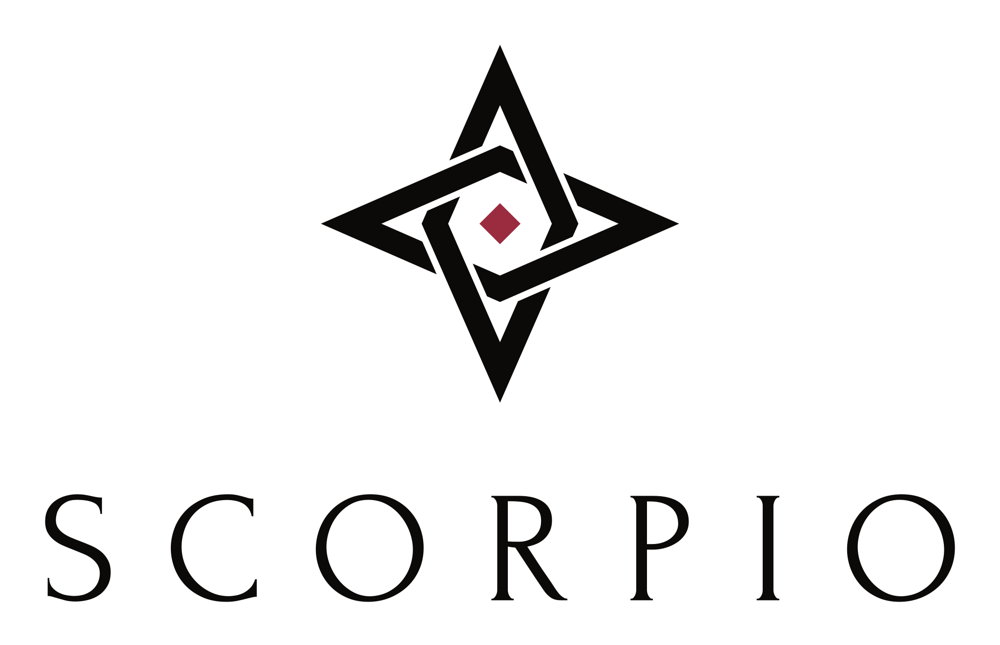
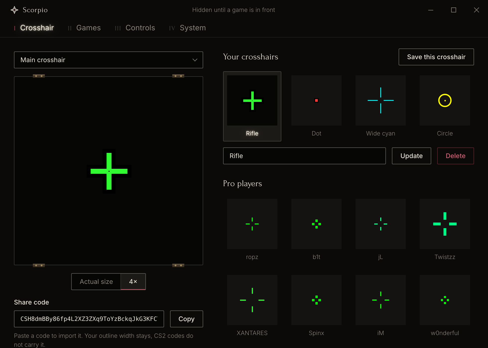
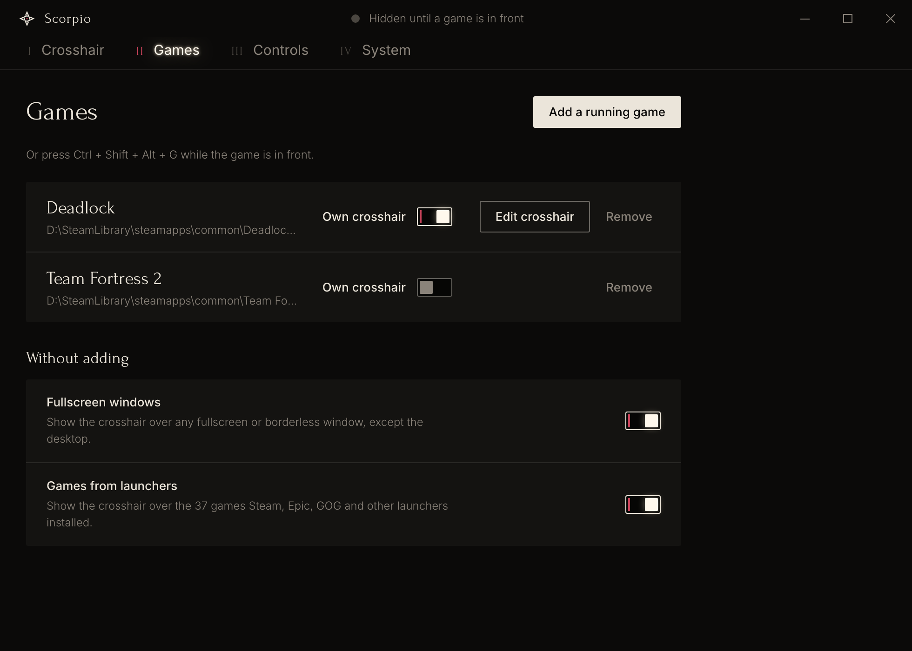
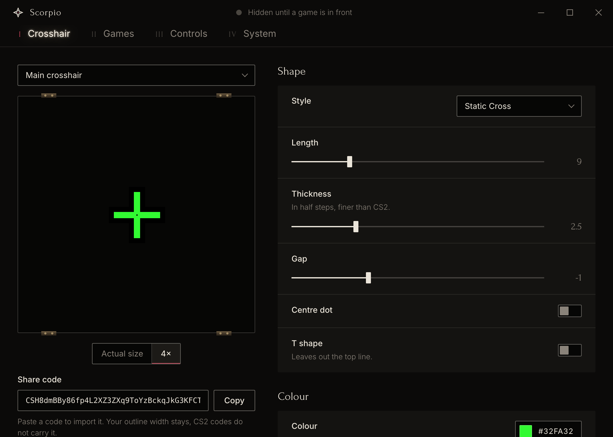
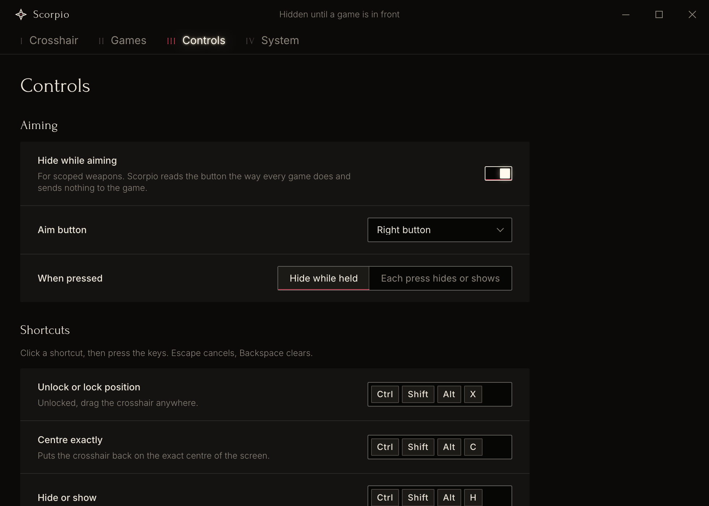
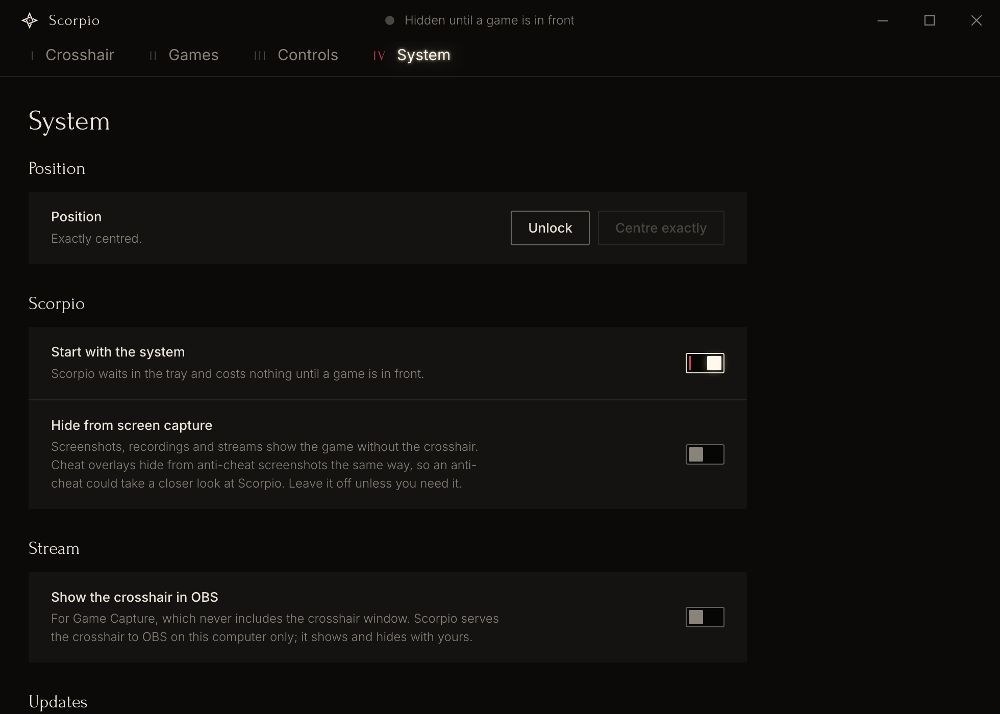
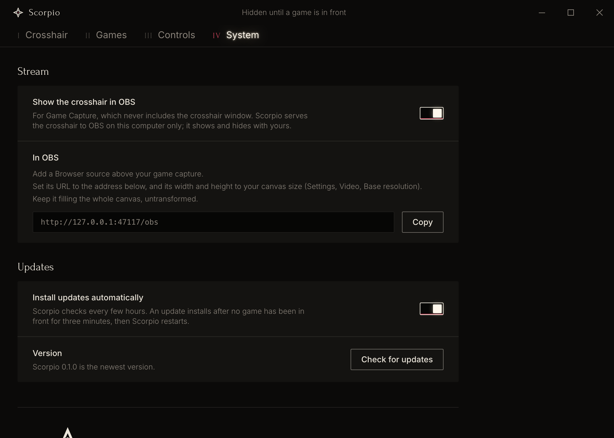

# Scorpio crosshair overlay

Scorpio is a free crosshair overlay for PC games on Windows and Linux. It draws a CS2-based crosshair in its own window over your game, shows it only while a game is in front, and never opens, reads, hooks or injects into the game or its anti-cheat.

<p align="center">
  <picture>
    <source media="(prefers-color-scheme: dark)" srcset="assets/brand/scorpio-lockup.svg">
    
  </picture>
</p>

<p align="center">
  <b><a href="https://github.com/Deikus-LXXVII/Scorpio-Crosshair/releases/latest">Download Scorpio</a></b><br>
  Windows installer, Linux AppImage and <code>.deb</code>. Free for non-commercial use.
</p>

<p align="center">
  <a href="https://scorpio.lxxvll.com/">Website</a> ·
  <a href="#is-scorpio-safe-with-anti-cheats">Anti-cheat safety</a> ·
  <a href="#faq">FAQ</a>
</p>

<p align="center">
  
</p>

| | |
| --- | --- |
| What it is | A crosshair overlay: a transparent, click-through window on top of the game |
| Systems | Windows 10 and 11. Linux with X11 or XWayland |
| Crosshair | CS2-based, five static styles; CS2 crosshair codes work. Or your own image: PNG, JPG, WebP, GIF or SVG |
| When it shows | Only while a game is the window in front, or always if you choose |
| Memory and CPU | 6.9 MB of private memory and 0 ms of CPU time over 10 s while it waits (measured on Windows 11) |
| Price | Free |
| Licence | PolyForm Noncommercial 1.0.0. Source-available, free for non-commercial use |
| Written in | Rust, with Tauri 2 |
| Version | 0.1.3 |

Scorpio is new. [What is tested and what is not](#what-is-tested-and-what-is-not) lists what has been proven so far.

## Features

### The crosshair shows only over games

Scorpio waits in the tray and shows the crosshair when the window in front is a game. The crosshair disappears at once when you switch to another window. A window counts as a game in three ways:

- **You added it.** Pick the game from the list of open windows, or press `Ctrl+Shift+Alt+G` while the game is in front. Scorpio stores four checks for the game: program name, program path, window title and window class. Two matching checks are enough, so a changed window title or a moved folder does not break the match.
- **It is fullscreen.** Any fullscreen or borderless window counts, except the desktop.
- **A launcher installed it.** Scorpio reads the install folders that the launchers record. On Windows these are Steam, Epic Games, GOG, Ubisoft Connect, EA, Battle.net, Riot and Xbox. On Linux these are Steam, Heroic and Lutris.

The second and the third way each have a switch. Both are on by default.

**Always show** keeps the crosshair on whatever is in front, the desktop included. Hide while aiming and the hide shortcut still work. It stays on the monitor of the window in front; with nothing in front, on the monitor last used.

<p align="center">
  
</p>

### CS2-based crosshairs

- **Five static styles.** Static Cross, Static Circle, Dot Only, Static Square and Static Quad.
- **The settings you know.** Length, thickness, gap, centre dot, T shape, colour, opacity and outline.
- **CS2 crosshair codes work in Scorpio.** Paste a code to import it; Scorpio reads codes that start with `CSGO-` or `CS`. Copy gives a code you can paste back.
- **Finer in two places.** Thickness moves in half steps. The outline can be 1 to 6 pixels wide. A share code carries neither, so thickness is rounded in a copied code and the outline width stays in Scorpio.
- **Static only.** A code with a dynamic style is shown as the static style it rests as. An overlay cannot know when you move or shoot.
- **13 pro crosshairs.** ropz, b1t, jL, Twistzz, XANTARES, Spinx, iM, w0nderful, karrigan, apEX, sh1ro, flameZ and mezii. The codes were seen in their matches and confirmed by a second source. They do not come from the players, the teams or Valve.
- **Saved crosshairs.** Save up to 100, rename them, and step through them with a shortcut.
- **A crosshair per game.** An added game can have its own crosshair. You edit it in the same editor.
- **Exact centring.** Scorpio places the crosshair on the centre of the monitor that the game is on, between the two centre pixels where a game draws its own crosshair. At 125 % or 150 % display scaling it picks the window size whose middle lands closest. You can also unlock the crosshair, drag it anywhere, and lock it again.
- **Centre on the game window.** For a windowed game, the crosshair can sit on the middle of the game's window instead of its monitor, and follows the window when you move or resize it. Its CS2 sizes then scale with the window's height, as in the game.

### Your own image

Choose **Your image** on the Crosshair tab and pick a PNG, JPG, WebP, GIF or SVG file of up to 5 MB. A GIF shows its first frame. You set the size (up to 512 pixels on the longer side) and the opacity. Scorpio draws the image at exactly that size, so an SVG stays sharp at any size and a pixel-art PNG keeps hard pixels at whole-number sizes. The image's centre is the crosshair's centre, placed the same way as a CS2 crosshair. A game with its own crosshair can have its own image. The image also reaches OBS through the Browser source.

<p align="center">
  
</p>

### Controls

**Hide while aiming** is for scoped weapons. Scorpio hides the crosshair while you hold the aim button, or switches it on each press. To choose the button, click the field and press any mouse button or key. Scorpio reads it through raw input, the way a game does, and sends nothing to the game. The keyboard is read only when the aim is a key, and only while the crosshair is up. The setting is off by default.

Global shortcuts work while the game is in front:

| Action | Default shortcut |
| --- | --- |
| Unlock or lock the position | `Ctrl+Shift+Alt+X` |
| Centre exactly | `Ctrl+Shift+Alt+C` |
| Hide or show | `Ctrl+Shift+Alt+H` |
| Next saved crosshair | `Ctrl+Shift+Alt+.` |
| Previous saved crosshair | `Ctrl+Shift+Alt+,` |
| Add the game in front | `Ctrl+Shift+Alt+G` |

You can change every shortcut. A shortcut needs Ctrl, Alt or Super unless it is an F-key, so it cannot take a key that the game uses.

<p align="center">
  
</p>

### Stream, updates and weight

- **OBS.** An opt-in Browser source puts the crosshair into your stream, also when OBS records with Game Capture. See [Show the crosshair in OBS](#show-the-crosshair-in-obs).
- **Updates between games.** Scorpio checks for a new version 30 seconds after it starts and then every 6 hours. It installs an update only after no game has been in front for 3 minutes, so a restart never lands in a match. Update packages are signed. You can switch automatic updates off and use the **Check for updates** button.
- **Light.** While it waits in the tray, Scorpio uses 6.9 MB of private memory and 0 ms of CPU time over 10 seconds. Every input is an event, and nothing polls. The settings window exists only while it is open. `scorpio.exe` is 3.7 MB. The figures are in [docs/budget.md](docs/budget.md), and a check fails when one of them grows by more than 25 %.

## Is Scorpio safe with anti-cheats?

Scorpio is built so that it has no contact with the game. It is a separate window on top of the game, and it works only with what the operating system tells every program about windows and input. No overlay can promise that you will never be banned. No anti-cheat vendor has approved Scorpio directly, but Scorpio crosses none of their lines: it never touches the game or the anti-cheat. What follows is what Scorpio does and does not do on your computer, so you can judge for yourself.

Scorpio never does any of the following:

- open a handle to another process (`OpenProcess` is banned in the code)
- read or write another process's memory
- inject a DLL or any other code
- install a hook of any kind, including low-level keyboard and mouse hooks
- send synthetic input (`SendInput`, `keybd_event`)
- load a kernel driver
- hook DirectX or Vulkan, or draw into the game's frames
- scan the modules of other processes

This table lists every operating system call that Scorpio makes to do its work.

| Need | Windows | Linux (X11) | Why it stays outside the game |
| --- | --- | --- | --- |
| Which window is in front | `SetWinEventHook(EVENT_SYSTEM_FOREGROUND, WINEVENT_OUTOFCONTEXT)` | `PropertyNotify` on the root window's `_NET_ACTIVE_WINDOW` | Out of context, so nothing is loaded into another process. An event, not a poll |
| The window's process id, title, class and size | `GetWindowThreadProcessId`, `GetWindowTextW`, `GetClassNameW`, `GetWindowRect`, `MonitorFromWindow` | `_NET_WM_PID`, `WM_CLASS`, `_NET_WM_NAME`, `_NET_WM_STATE` | Window manager data. No process is opened |
| The program's path | `NtQuerySystemInformation(SystemProcessIdInformation)` | `/proc/<pid>/exe`, or `cmdline` for Wine | No process handle is opened |
| Aim button and hide key | Raw Input with `RIDEV_INPUTSINK` on Scorpio's own hidden window | XInput2 raw events on the root window | The input API that games themselves read. No hooks |
| Shortcuts | `RegisterHotKey` | `XGrabKey` | The standard API for global shortcuts |
| The crosshair | A layered, topmost, click-through window | An override-redirect ARGB window with an empty input shape | A separate window. Nothing is drawn into the game |
| Colour pipette | One screen grab when you click **Pick** | Not available | Only on request |
| Crosshair in OBS, opt-in | An HTTP server on `127.0.0.1:47117` | The same | Talks only to OBS on the same computer. No thread or socket while it is off |
| Hide from screen capture, opt-in | `SetWindowDisplayAffinity(WDA_EXCLUDEFROMCAPTURE)` on Scorpio's own window | Not available | See the exception below |

### The one exception: Hide from screen capture

**Hide from screen capture** is a switch on the System tab, for Windows only. When it is on, screenshots, recordings and streams show the game without the crosshair.

This switch is not risk-free, and it is off by default. Cheat overlays use the same Windows call to hide from the screenshots that an anti-cheat takes. An anti-cheat that sees a hidden window over the game could take a closer look at Scorpio. Leave the switch off unless you need it. To keep the crosshair in a stream, or to keep it out of one, use the [OBS source](#show-the-crosshair-in-obs) instead: it needs no hidden window.

<p align="center">
  
</p>

### What this does not cover

A game's terms or a tournament's rules can forbid external crosshairs whatever the technique. Scorpio's design removes the technical contact with the game. It does not change those rules. Check the rules of the game that you play.

## Install

### Windows

1. Open the [latest release](https://github.com/Deikus-LXXVII/Scorpio-Crosshair/releases/latest) and download the file that ends in `-setup.exe`.
2. Run the installer. It installs for your user account and does not ask for administrator rights.
3. Scorpio starts in the tray. Click the tray icon to open the settings window.

The installer is not signed with a Windows code-signing certificate, so Windows SmartScreen can show a warning the first time. The settings window uses Microsoft Edge WebView2. Windows 11 includes it, and the installer downloads it when it is missing.

### Linux

Scorpio needs X11 or XWayland. On a Wayland desktop it runs through XWayland, and it sees only games that are X11 windows. A game that runs as a native Wayland window is invisible to it. Wayland without XWayland is not supported.

**AppImage.** Download the `.AppImage` file from the [latest release](https://github.com/Deikus-LXXVII/Scorpio-Crosshair/releases/latest), make it executable, and run it. The AppImage updates itself.

```sh
chmod +x Scorpio_*.AppImage
./Scorpio_*.AppImage
```

**Debian and Ubuntu.** Download the `.deb` file and install it. A `.deb` install does not update itself. Install a newer `.deb` to update.

```sh
sudo apt install ./Scorpio_*.deb
```

Two things differ from Windows. **Hide from screen capture** is disabled, because X11 has no way to keep a window out of captures. The **Pick** button of the colour picker is absent, because WebKitGTK has no pipette.

### First steps

1. Click the tray icon. The settings window opens on the **Crosshair** tab.
2. Paste a CS2 crosshair code into **Share code**, or set the crosshair with the sliders.
3. Open the **Games** tab and click **Add a game**. You can skip this step for a fullscreen game or a game from a launcher.
4. Switch to the game. The crosshair shows. The line in the title bar of the settings window says what the overlay does now, for example "Hidden until a game is in front".

## Show the crosshair in OBS

OBS Game Capture reads the game's own frames, so a crosshair in a separate window is never in the recording. Scorpio can serve the same crosshair to OBS as a Browser source. The source shows and hides together with the crosshair on your screen.

1. In Scorpio, open the **System** tab and switch on **Show the crosshair in OBS**.
2. In OBS, add a **Browser** source above your game capture.
3. Set the URL of the source to `http://127.0.0.1:47117/obs`.
4. Set the width and the height of the source to your canvas size. OBS shows the canvas size under **Settings**, **Video**, **Base (Canvas) Resolution**.
5. Keep the source filling the whole canvas, with no transform.

Scorpio scales the crosshair from the height of your game's screen to the height of the canvas, so it lands where it does on your screen. The server listens on `127.0.0.1` only, so nothing outside your computer can reach it. While the switch is off, Scorpio opens no socket and runs no server thread.

<p align="center">
  
</p>

## FAQ

### Is a crosshair overlay bannable?

It depends on the game's rules, and no overlay can promise that you will never be banned. Anti-cheats look for programs that read or change a game. Scorpio does neither. It is a separate transparent window on top of the game, and it never opens the game's process, reads its memory, hooks it, injects code or sends input. A game's terms can still forbid external crosshairs, so check the rules of the game that you play. No anti-cheat vendor has approved Scorpio directly, but it crosses none of their lines. See [Is Scorpio safe with anti-cheats?](#is-scorpio-safe-with-anti-cheats)

### Does Scorpio work with Vanguard, Easy Anti-Cheat, BattlEye or VAC?

None of them has approved it directly. Scorpio crosses none of their lines, since it never touches the game's process or the anti-cheat's process; the full list of its system calls is in the [safety section](#is-scorpio-safe-with-anti-cheats). The exception is a game whose own rules forbid crosshair overlays.

### Do CS2 crosshair codes work in Scorpio?

Yes. Copy the code from your game's crosshair settings or from a site that lists pro crosshairs. In Scorpio, open the **Crosshair** tab and paste the code into **Share code**. Scorpio draws the same crosshair over any game it detects. A dynamic crosshair is shown in its static resting style.

### Can I take my Scorpio crosshair back into the game?

Yes. Click **Copy** next to the share code and import the code in the game. Thickness in half steps is rounded in the code, and an outline wider than 1 pixel stays in Scorpio, because share codes carry neither.

### Does Scorpio work on Linux?

Scorpio is built for Linux with X11 or XWayland, as an AppImage and a `.deb`. It is less proven there than on Windows: the X11 layer has run under a virtual X server, and the full app has not been tested on a Linux desktop or in a game yet. Native Wayland windows are not supported.

### Does the crosshair show on my stream or recording?

With OBS Display Capture it does, because Display Capture records the screen. With OBS Game Capture it does not, until you add Scorpio's Browser source. See [Show the crosshair in OBS](#show-the-crosshair-in-obs). To keep the crosshair out of every capture on Windows, there is **Hide from screen capture**, with the risk described in the safety section.

### Why does the crosshair not show over my game?

Check these in order:

1. The title bar of the settings window says "Hidden by shortcut". Press the hide shortcut again.
2. Scorpio does not see the window as a game. Add the game on the **Games** tab.
3. The game runs in exclusive fullscreen. Windows may not draw other windows over an exclusive fullscreen game. Switch the game to borderless or windowed fullscreen.
4. On Linux, the game runs as a native Wayland window. Scorpio sees only X11 windows.

### Does Scorpio lower my frame rate or add input lag?

Scorpio does not touch the game or its input. While it waits, it uses 0 ms of CPU time over 10 seconds and 6.9 MB of memory. Its effect on the frame rate inside a running game has not been measured yet.

### Can I use an image or a custom shape as a crosshair?

Yes. On the Crosshair tab, choose **Your image** and pick a PNG, JPG, WebP, GIF (first frame) or SVG file of up to 5 MB. You set its size, up to 512 pixels, and its opacity. See [Your own image](#your-own-image).

### Which pro players' crosshairs are included?

Thirteen: ropz, b1t, jL, Twistzz, XANTARES, Spinx, iM, w0nderful, karrigan, apEX, sh1ro, flameZ and mezii. The codes were seen in their matches and confirmed by a second source. The players did not provide or endorse them.

### Does Scorpio collect data or go online?

Scorpio has no telemetry and no account. It makes one kind of request: the update check to this repository's releases on GitHub, and the download of an update. With automatic updates off, it checks only when you click **Check for updates**. The OBS source listens on your own computer only, and only while it is on.

### Where does Scorpio keep its settings?

In one file, `settings.json`, with your images beside it in `images`. On Windows the folder is `%APPDATA%\com.lxxvii.scorpio`. On Linux it is `~/.config/com.lxxvii.scorpio`. See [Troubleshooting](#troubleshooting) for the log.

### Is Scorpio open source?

The source is public and you can read it, change it and share your own versions for any non-commercial purpose. The licence is PolyForm Noncommercial 1.0.0, which forbids commercial use, so Scorpio is source-available and not open source in the OSI sense.

### Does Scorpio run on macOS?

No. Scorpio is for Windows and Linux.

## What is tested and what is not

Scorpio is at version 0.1.3. This is the state on 2026-11-21.

| Area | State |
| --- | --- |
| Crosshair maths, share codes, game matching, launcher parsers, app state | Unit tests (`npm test`) |
| Windows build | Built, run and driven on Windows 11. Memory and CPU measured idle and with the settings window |
| Windows, inside a real game session | Not tested yet |
| Linux X11 layer | Run under a virtual X server (Xvfb). The full app has not been run or measured on a Linux desktop |
| Crosshair in OBS | The local server has a test. Not tested inside OBS yet |
| Your own image | Drawing, size changes and file checks run in headless Chromium with a stand-in for Scorpio; the PNG check and the bitmap have unit tests. Not yet tried in the real settings window on Windows or Linux |
| Centre on the game window | Following a window's moves is run under Xvfb on Linux and with a test window on Windows. Not tried with a game |
| Log and problem report | The log and `--report` run on Linux under Xvfb and `--report` on Windows 11. The report window runs in headless Chromium with a stand-in |
| Automatic updates | Written. Not yet exercised against a published release |
| Settings window | Rendered in headless Chromium. Not yet checked in WebKitGTK |
| Any specific anti-cheat | Not tested |

Known gaps:

- A game that turns borderless fullscreen after it came to the front is seen only at the next focus or display change.
- A window that is still invisible when it comes to the front is ignored until the next focus change.
- One added UWP game matches every UWP app, because they share a host process.

## Troubleshooting

**Report a problem.** On the **System** tab, click **Show the report**. You see the whole report first: Scorpio's version, your system, your settings, and the last 200 lines of the log, with your user folder written as `~` and your user name as `<user>`. Then you can copy it, save it as a file in your Downloads folder, or click **Report on GitHub**, which saves the file and opens a new issue in your browser with a short text that asks you to attach it. Scorpio never sends anything by itself and has no telemetry.

**Files.**

| | Windows | Linux |
| --- | --- | --- |
| Settings | `%APPDATA%\com.lxxvii.scorpio\settings.json` | `~/.config/com.lxxvii.scorpio/settings.json` |
| Your images | `%APPDATA%\com.lxxvii.scorpio\images\` | `~/.config/com.lxxvii.scorpio/images/` |
| Log | `%LOCALAPPDATA%\com.lxxvii.scorpio\logs\scorpio.log` | `~/.local/share/com.lxxvii.scorpio/logs/scorpio.log` |

The log is plain text, one line per event: `2026-11-21T08:01:55Z INFO  scorpio_lib: platform started`. The time is UTC. Scorpio writes its own lines from the debug level up (start, focus decisions, what the overlay does, updates, the OBS source, errors and panics) and other libraries' lines only from warnings up. Window titles are never logged. At 1 MB the log moves to `scorpio.old.log`, replacing the one before, so the two files hold at most 2 MB. A settings file that cannot be read is kept beside it as `settings.broken-<seconds>.json`.

**For scripts and AI agents.** `scorpio --report` prints the same report to standard output and exits without starting Scorpio, even while Scorpio runs. It cannot say what the running app is doing; the log can. On Windows, redirect it to a file, because the program has no console of its own: `"%LOCALAPPDATA%\Scorpio\scorpio.exe" --report > scorpio-report.txt`. On Linux, run `scorpio --report`, or the AppImage with `--report`.

The screenshots on this page show the real settings window in headless Chromium with sample data.

## Build from source

You need Rust 1.80 or newer, Node.js, and the [Tauri 2 prerequisites](https://v2.tauri.app/start/prerequisites/) for your system.

```sh
git clone https://github.com/Deikus-LXXVII/Scorpio-Crosshair.git
cd Scorpio-Crosshair
npm install
npm test        # the Rust unit tests
npm run dev     # run from source
npm run build   # build the installer or the packages
```

`npm run build` writes the NSIS installer on Windows, and the AppImage and the `.deb` on Linux, under `src-tauri/target/release/bundle/`.

## How Scorpio is built

One small native process does everything that runs while you play. The settings window is a web view that exists only while it is open.

```
scorpio (Rust, Tauri 2)
├── core/        pure logic with unit tests, no OS calls
│   ├── crosshair    CS2-based settings, share codes, shapes in pixels
│   ├── raster       shapes to a premultiplied RGBA bitmap
│   ├── center       exact centring
│   ├── focus        the two-of-four match
│   └── launchers    install folders from launcher files
├── platform/    the only code that talks to the OS
│   ├── windows      layered overlay window, foreground and location events, Raw Input
│   └── linux        X11 override-redirect overlay, active-window and configure events, XInput2
├── app          state machine: locked, focus, aiming, where to centre
├── store        settings file, defaults, validation
├── picture      your image: PNG check, premultiplied bitmap, its files
├── logging      the log file, its cap, the panic hook
├── report       the problem report and `--report`
├── obs          the Browser source server
├── update       signed updates between games
└── ui/          the settings window (HTML, CSS, JS), opened on demand
```

More detail:

- [docs/plans/scorpio.md](docs/plans/scorpio.md) has the plan, the anti-cheat review of every OS call, and the known gaps.
- [docs/budget.md](docs/budget.md) has the measured memory, CPU and size, with their budgets.
- [docs/style-audit.md](docs/style-audit.md) explains the decisions behind the settings window.
- [assets/brand/README.md](assets/brand/README.md) describes the logo and its files.

## The name and the logo

A Roman *scorpio* was the legion's small torsion bolt-thrower, its precision weapon. The logo is called Nodus. Two long bands, each the shape of a bolt head, are interlaced like the rope of the scorpio's two torsion springs, and they hold one red point: the aim.

## Licence

Scorpio is under the [PolyForm Noncommercial License 1.0.0](LICENSE). You may use it, change it and share your own versions for any non-commercial purpose. Commercial use is not allowed. Copyright 2026 LXXVII.

The fonts Forum and Inter are under the SIL Open Font License 1.1 (`ui/fonts/OFL-Forum.txt`, `ui/fonts/OFL-Inter.txt`). The share code layouts follow the documentation of [akiver/csgo-sharecode](https://github.com/akiver/csgo-sharecode) (MIT).
