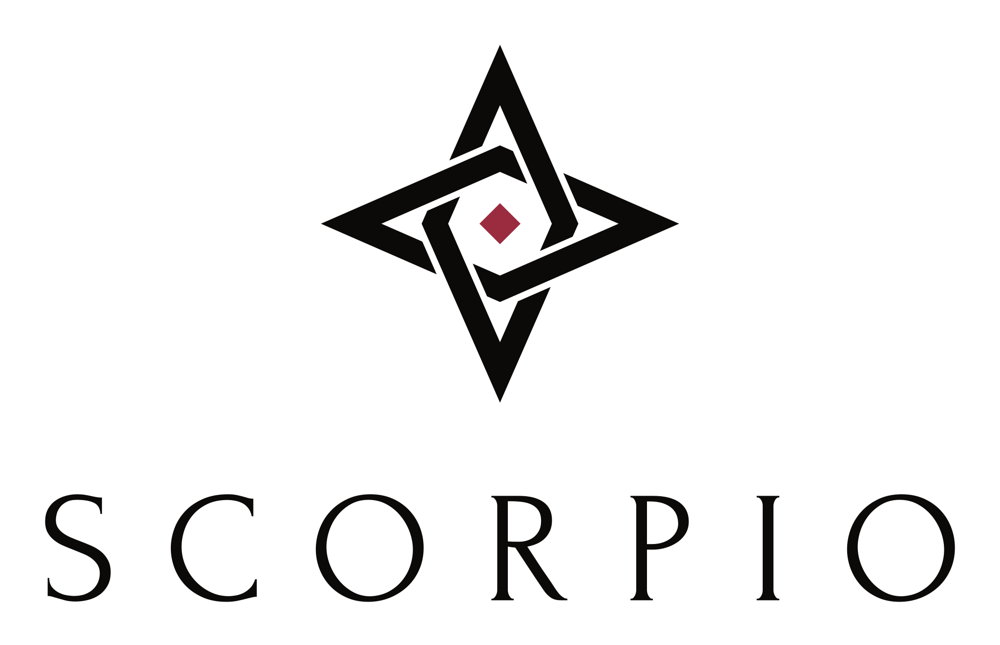
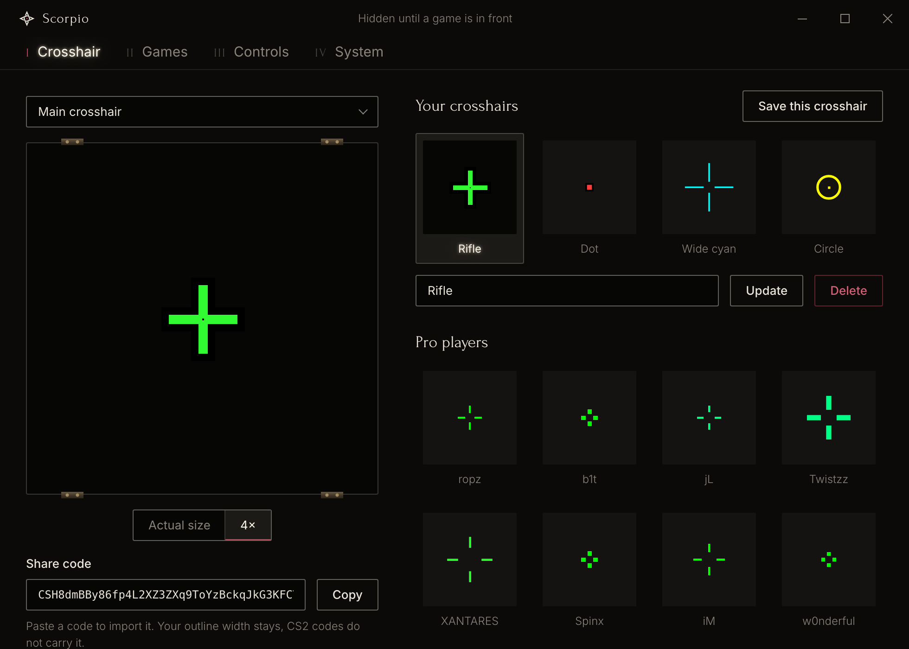

# Scorpio: прицел поверх игры

Scorpio показывает прицел из Counter-Strike 2 (CS2) поверх игр на Windows и Linux. Программа бесплатная. Она рисует прицел в собственном окне, показывает его только пока игра на переднем плане и никогда не открывает, не читает, не перехватывает игру и её античит и не внедряется в них.

<p align="center">
  <picture>
    <source media="(prefers-color-scheme: dark)" srcset="assets/brand/scorpio-lockup.svg">
    
  </picture>
</p>

<p align="center">
  <b><a href="https://github.com/Deikus-LXXVII/Scorpio-Crosshair/releases/latest">Скачать Scorpio</a></b><br>
  Установщик для Windows, AppImage и <code>.deb</code> для Linux. Бесплатно для некоммерческого использования.
</p>

<p align="center">
  <a href="README.md">English</a> ·
  <a href="https://scorpio.lxxvll.com/">Сайт</a>
</p>

<p align="center">
  
</p>

Это краткая русская версия. Полное описание, таблица всех системных вызовов и сборка из исходников есть в [английском README](README.md). Интерфейс программы на английском, поэтому названия вкладок и переключателей приведены как в программе.

| | |
| --- | --- |
| Что это | Оверлей прицела: прозрачное окно поверх игры, которое пропускает клики |
| Системы | Windows 10 и 11. Linux с X11 или XWayland |
| Прицел | Настройки и коды прицела CS2, пять статичных стилей |
| Когда виден | Только пока окно игры на переднем плане |
| Память и процессор | 6,9 МБ памяти и 0 мс процессорного времени за 10 секунд в ожидании (измерено на Windows 11) |
| Цена | Бесплатно |
| Лицензия | PolyForm Noncommercial 1.0.0. Исходный код открыт для чтения, коммерческое использование запрещено |
| Написан на | Rust и Tauri 2 |
| Версия | 0.1.1 |

## Возможности

**Прицел виден только в играх.** Scorpio ждёт в области уведомлений и показывает прицел, когда на переднем плане игра. Игрой считается окно, которое вы добавили сами, любое полноэкранное окно и игра, установленная через лаунчер. На Windows это Steam, Epic Games, GOG, Ubisoft Connect, EA, Battle.net, Riot и Xbox. На Linux это Steam, Heroic и Lutris. Добавленную игру Scorpio узнаёт по двум совпадениям из четырёх: имя программы, путь к ней, заголовок окна и класс окна.

**Прицел как в CS2.** Пять статичных стилей и настройки CS2: длина, толщина, зазор, точка в центре, Т-образная форма, цвет, прозрачность и обводка. Вставьте код прицела CS2 или CS:GO в поле **Share code**, и Scorpio нарисует этот прицел. Кнопка **Copy** даёт код, который принимает CS2.

**Точнее, чем в CS2.** Толщина меняется с шагом 0,5. Обводка бывает шириной от 1 до 6 пикселей, а в CS2 только 1 пиксель. Код прицела эти два значения не хранит.

**Прицелы профессионалов.** В программе есть 13 прицелов: ropz, b1t, jL, Twistzz, XANTARES, Spinx, iM, w0nderful, karrigan, apEX, sh1ro, flameZ и mezii. Коды замечены в их матчах и подтверждены вторым источником. Игроки их не передавали и не одобряли.

**Свой прицел для каждой игры** и список сохранённых прицелов, которые переключаются сочетанием клавиш.

**Точное центрирование.** Scorpio ставит прицел в центр того монитора, на котором идёт игра. Прицел можно разблокировать, перетащить в любое место и закрепить снова.

**Скрытие при прицеливании.** Для оружия с оптикой. Scorpio прячет прицел, пока зажата кнопка прицеливания, или переключает его по нажатию. Кнопку он читает через Raw Input, как сама игра, и ничего в игру не отправляет.

**Сочетания клавиш.** По умолчанию: `Ctrl+Shift+Alt+H` скрывает и показывает прицел, `Ctrl+Shift+Alt+X` разблокирует и закрепляет его положение, `Ctrl+Shift+Alt+C` возвращает его точно в центр, `Ctrl+Shift+Alt+G` добавляет игру, которая сейчас на переднем плане. Все сочетания можно изменить.

**Обновления между играми.** Scorpio проверяет новую версию каждые 6 часов и ставит её только после того, как три минуты на переднем плане не было игры. Пакеты обновлений подписаны.

## Безопасно ли это с античитами

Scorpio устроен так, чтобы не соприкасаться с игрой. Это отдельное окно поверх игры. Оно пользуется только теми сведениями об окнах и вводе, которые операционная система даёт любой программе.

Scorpio никогда не делает следующего:

- не открывает чужой процесс (`OpenProcess` запрещён в коде)
- не читает и не пишет чужую память
- не внедряет DLL и другой код
- не ставит хуки, в том числе низкоуровневые хуки клавиатуры и мыши
- не отправляет синтетический ввод
- не загружает драйвер ядра
- не перехватывает DirectX и Vulkan и не рисует в кадрах игры

Ни один оверлей не может обещать, что вас не заблокируют. Ни один разработчик античитов не проверял и не одобрял Scorpio. Правила игры или турнира могут запрещать сторонние прицелы независимо от того, как они сделаны, поэтому сверьтесь с правилами своей игры.

Есть одно исключение, переключатель **Hide from screen capture** на вкладке **System**. Он работает только в Windows и по умолчанию выключен. С ним снимки экрана, записи и трансляции показывают игру без прицела. Читерские оверлеи прячутся от снимков античита тем же вызовом Windows, поэтому античит может присмотреться к Scorpio внимательнее. Не включайте его без необходимости.

## Установка

**Windows.** Откройте [последний выпуск](https://github.com/Deikus-LXXVII/Scorpio-Crosshair/releases/latest) и скачайте файл, имя которого кончается на `-setup.exe`. Установщик ставит программу для вашей учётной записи и не просит прав администратора. Он не подписан сертификатом для подписи кода, поэтому SmartScreen при первом запуске может показать предупреждение.

**Linux.** Нужен X11 или XWayland. Игру, которая работает как родное окно Wayland, Scorpio не видит. Скачайте `.AppImage`, сделайте файл исполняемым и запустите. AppImage обновляется сам. Для Debian и Ubuntu есть пакет `.deb`.

```sh
chmod +x Scorpio_*.AppImage
./Scorpio_*.AppImage
```

После установки Scorpio появляется в области уведомлений. Нажмите на значок, вставьте код прицела на вкладке **Crosshair** и переключитесь в игру.

## Прицел в OBS

Источник «Захват игры» в OBS читает кадры самой игры, поэтому прицел из отдельного окна в запись не попадает. Scorpio может отдать тот же прицел в OBS как источник «Браузер».

1. В Scorpio откройте вкладку **System** и включите **Show the crosshair in OBS**.
2. В OBS добавьте источник «Браузер» выше захвата игры.
3. Укажите адрес `http://127.0.0.1:47117/obs`.
4. Задайте ширину и высоту источника по размеру холста.
5. Оставьте источник на весь холст, без трансформаций.

Сервер слушает только на вашем компьютере. Пока переключатель выключен, Scorpio не открывает ни одного сокета.

## Частые вопросы

### Забанят ли за оверлей прицела?

Это зависит от правил игры, и ни один оверлей не может обещать, что блокировки не будет. Античиты ищут программы, которые читают или меняют игру. Scorpio не делает ни того, ни другого. Это отдельное прозрачное окно поверх игры. Он не открывает процесс игры, не читает её память, не ставит хуки, не внедряет код и не отправляет ввод. Правила игры всё равно могут запрещать сторонние прицелы. Scorpio пока не проверяли ни с одним конкретным античитом.

### Как использовать прицел из CS2 в других играх?

Скопируйте код прицела в CS2 или на сайте с прицелами профессионалов. В Scorpio откройте вкладку **Crosshair** и вставьте код в поле **Share code**. Scorpio покажет этот прицел поверх любой игры, которую распознает. Динамический прицел показывается в статичном виде, каким он выглядит в покое.

### Работает ли Scorpio на Linux?

Scorpio собран для Linux с X11 или XWayland. Там он проверен меньше, чем на Windows: слой X11 запускали на виртуальном X-сервере, а всю программу на рабочем столе Linux и в игре ещё не проверяли.

### Почему прицел не виден поверх игры?

Проверьте по порядку. Строка в заголовке окна настроек может сообщать «Hidden by shortcut». Тогда нажмите сочетание скрытия ещё раз. Scorpio может не считать окно игрой. Тогда добавьте игру на вкладке **Games**. Игра может работать в эксклюзивном полноэкранном режиме, а поверх него Windows может не рисовать другие окна. Тогда переключите игру в оконный режим без рамки.

### Можно ли поставить картинку вместо прицела?

Нет. В Scorpio есть только система прицелов CS2.

### Scorpio собирает данные?

Нет. В программе нет телеметрии и учётных записей. Она обращается в сеть только за обновлениями, к выпускам этого репозитория на GitHub.

### Это открытый исходный код?

Исходный код опубликован. Его можно читать, менять и распространять свои версии в некоммерческих целях. Лицензия PolyForm Noncommercial 1.0.0 запрещает коммерческое использование, поэтому по определению OSI это не открытое ПО.

## Что проверено

Версия 0.1.1, состояние на 21 ноября 2026 года.

- Математика прицела, коды, распознавание игр и разбор файлов лаунчеров покрыты модульными тестами.
- Сборку для Windows запускали и измеряли на Windows 11.
- В настоящей игровой сессии программу ещё не проверяли.
- Источник для OBS внутри OBS ещё не проверяли.
- Автоматические обновления ещё не проверяли на опубликованном выпуске.
- Снимки экрана на этой странице показывают настоящее окно настроек с примерными данными.

## Название

Скорпионом римляне называли малую торсионную стреломётную машину легиона, его точное оружие.

## Лицензия

[PolyForm Noncommercial License 1.0.0](LICENSE). Программой можно пользоваться, её можно менять и распространять свои версии в некоммерческих целях. Коммерческое использование запрещено. © 2026 LXXVII.
