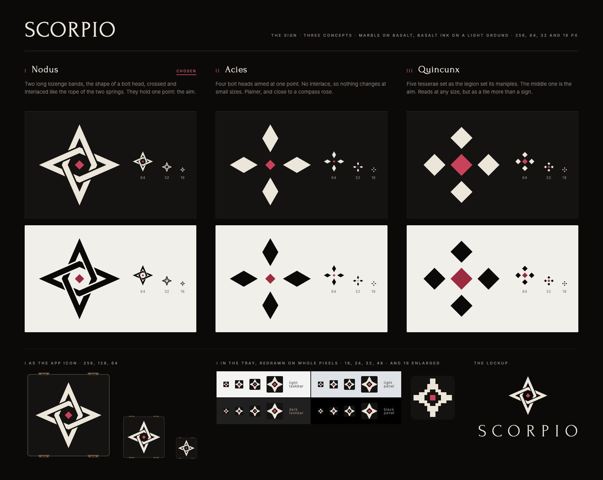

# Scorpio: the sign

The sign is abstract. Two long lozenge bands, each the shape of a bolt head, are crossed and interlaced like the rope of the scorpio's two torsion springs, and between them they hold one porphyry point: the aim. It has one band weight, four-way symmetry and straight cuts only, and its four arms and centre work as a crosshair.

The weapon and the legion are the meaning behind the sign, not its picture.

## Files

| File | Use |
| --- | --- |
| `scorpio-mark.svg` | The mark alone, marble with the porphyry point, on a transparent ground. For dark grounds. |
| `scorpio-mark-dark.svg` | The mark in basalt ink with the darker porphyry. For light grounds. |
| `scorpio-lockup.svg`, `scorpio-lockup-dark.svg` | The mark over SCORPIO in Forum, widely spaced. The letters are outlines, so no font is needed. |
| `scorpio-icon.svg` | The app icon: the mark on a stone tablet with cut corners and four bronze cramps. Source of `tools/icon.png`. |
| `scorpio-tray.svg` | The tray icon, redrawn on a 16 px grid. Source of the 16 and 32 px sizes. |
| `scorpio-tray-24.svg` | The same on a 24 px grid. Source of the 24 and 48 px sizes. |
| `scorpio-tray-16.png`, `scorpio-tray-32.png` | The tray icon rendered at 16 and 32 px. |
| `concepts.png`, `concepts/` | The three concepts that were considered, and their vector sources. |

Colours are the style's tokens: marble `#ebe5da`, basalt `#0b0a09`, stone `#141311`, porphyry `#c8435a` on dark and `#9b2c3f` on light, and the bronze of the cramps.

## Small sizes

At 32 px and below the interlace cannot be drawn, so the tray icon is a second drawing of the same silhouette: a four-pointed ring round the point, with every edge on a whole pixel, on the stone tablet so that it reads on light and on dark taskbars.

Tauri gives the tray the 32 px icon (48 px at 150 % scaling) and the shell shrinks it to half. `tools/icon.js --icons` therefore stores the tray drawing at 16, 24, 32 and 48 px in `src-tauri/icons/icon.ico` and in `32x32.png`. The 32 and 48 px sizes are exact doubles of the 16 and 24 px drawings, so they halve without blur. Sizes from 64 px up come from `scorpio-icon.svg`.

## Rebuild

```
node tools/icon.js            # tools/icon.png and the two tray PNGs
node tools/icon.js --icons    # the same, then src-tauri/icons
```

The script needs a headless Chromium. It looks in the Playwright cache and the usual install places; set `CHROME` to use another binary. `--icons` runs `npx tauri icon tools/icon.png` and deletes the Android, iOS, Windows Store and macOS outputs, because Scorpio ships for Windows and Linux only.

## The concepts



1. **Nodus** (chosen). The interlaced bands. It is the only one of the three that is a sign of its own and not a pattern, and it keeps its silhouette down to 16 px.
2. **Acies.** Four bolt heads aimed at one point. The simplest, but close to a compass rose.
3. **Quincunx.** Five tesserae set as the legion set its maniples. It reads at any size, but as a tile.

## Licence of the letters

Forum is under the SIL Open Font License 1.1 (`ui/fonts/OFL-Forum.txt`). The licence allows the font to be used in artwork, and outlines in a logo are not a copy of the font.
